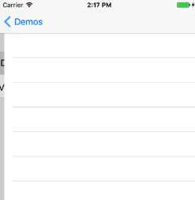

# RxRealm

[](https://github.com/RxSwiftCommunity/RxRealm/actions/workflows/ci.yml)
[](https://swiftpackageindex.com/RxSwiftCommunity/RxRealm)
[](https://swiftpackageindex.com/RxSwiftCommunity/RxRealm)
[](http://cocoapods.org/pods/RxRealm)
[](https://github.com/apple/swift-package-manager)
[](http://cocoapods.org/pods/RxRealm)

This library is a thin wrapper around __RealmSwift__ ( [Realm Docs](https://realm.io/docs/swift/latest/) ).

**Table of contents:**

 1. [Observing object collections](https://github.com/RxSwiftCommunity/RxRealm#observing-object-collections)
 2. [Observing a single object](https://github.com/RxSwiftCommunity/RxRealm#observing-a-single-object)
 3. [Write transactions](https://github.com/RxSwiftCommunity/RxRealm#write-transactions)
 4. [Automatically binding table and collection views](https://github.com/RxSwiftCommunity/RxRealm#automatically-binding-table-and-collection-views)
 5. [Example app](https://github.com/RxSwiftCommunity/RxRealm#example-app)

## Observing object collections

RxRealm can be used to create `Observable`s from objects of type `Results`, `List`, `LinkingObjects` or `AnyRealmCollection`. These types are typically used to load and observe object collections from the Realm Mobile Database.

### `Observable.collection(from:synchronousStart:)`

Emits an event each time the collection changes:

```swift
let realm = try! Realm()
let laps = realm.objects(Lap.self)

Observable.collection(from: laps)
  .map { 
    laps in "\(laps.count) laps"
  }
  .subscribe(onNext: { text  in
    print(text)
  })
```

The above prints out "X laps" each time a lap is added or removed from the database. If you set `synchronousStart` to `true` (the default value), the first element will be emitted synchronously - e.g. when you're binding UI it might not be possible for an asynchronous notification to come through.

### `Observable.array(from:synchronousStart:)`

Upon each change fetches a snapshot of the Realm collection and converts it to an array value (for example if you want to use array methods on the collection):

```swift
let realm = try! Realm()
let laps = realm.objects(Lap.self)

Observable.array(from: laps)
  .map { array in
    return array.prefix(3) //slice of first 3 items
  }
  .subscribe(onNext: { text  in
    print(text)
  })
```

### `Observable.changeset(from:synchronousStart:)`

Emits every time the collection changes and provides the exact indexes that has been deleted, inserted or updated:

```swift
let realm = try! Realm()
let laps = realm.objects(Lap.self)

Observable.changeset(from: laps)
  .subscribe(onNext: { results, changes in
    if let changes = changes {
      // it's an update
      print(results)
      print("deleted: \(changes.deleted)")
      print("inserted: \(changes.inserted)")
      print("updated: \(changes.updated)")
    } else {
      // it's the initial data
      print(results)
    }
  })
```

### `Observable.arrayWithChangeset(from:synchronousStart:)`

Combines the result of `Observable.array(from:)` and `Observable.changeset(from:)` returning an `Observable<Array<T>, RealmChangeset?>`

```swift
let realm = try! Realm()
let laps = realm.objects(Lap.self))

Observable.arrayWithChangeset(from: laps)
  .subscribe(onNext: { array, changes in
    if let changes = changes {
    // it's an update
    print(array.first)
    print("deleted: \(changes.deleted)")
    print("inserted: \(changes.inserted)")
    print("updated: \(changes.updated)")
  } else {
    // it's the initial data
    print(array)
  }
  })
```

## Observing a single object

There's a separate API to make it easier to observe a single object:

```swift
Observable.from(object: ticker)
    .map { ticker -> String in
        return "\(ticker.ticks) ticks"
    }
    .bind(to: footer.rx.text)
```

This API uses the [Realm object notifications](https://realm.io/news/realm-objc-swift-2.4/) under the hood to listen for changes.

This method will by default emit the object initial state as its first `next` event. You can disable this behavior by using the `emitInitialValue` parameter and setting it to `false`.

Finally you can set changes to which properties constitute an object change you'd like to observe for:

```swift
Observable.from(object: ticker, properties: ["name", "id", "family"]) ...
```

## Write transactions

### `rx.add()`

Writing objects to **existing** realm reference. You can add newly created objects to a Realm that you already have initialized:

```swift
let realm = try! Realm()
let messages = [Message("hello"), Message("world")]

Observable.from(messages)
  .subscribe(realm.rx.add())
```

Be careful, this will retain your Realm until the `Observable` completes or errors out.

### `Realm.rx.add()`

Writing to the default Realm. You can leave it to RxRealm to grab the default Realm on any thread your subscribe and write objects to it:

```swift
let messages = [Message("hello"), Message("world")]

Observable.from(messages)
  .subscribe(Realm.rx.add())
```

### `Realm.rx.add(configuration:)`

Writing to a **custom** Realm. If you want to switch threads and not use the default Realm, provide a `Realm.Configuration`. You an also provide an error handler for the observer to be called if either creating the realm reference or the write transaction raise an error:

```swift
var config = Realm.Configuration()
/* custom configuration settings */

let messages = [Message("hello"), Message("world")]
Observable.from(messages)
  .observe(on: /* you can switch threads here */ )
  .subscribe(Realm.rx.add(configuration: config, onError: {elements, error in
    if let elements = elements {
      print("Error \(error.localizedDescription) while saving objects \(String(describing: elements))")
    } else {
      print("Error \(error.localizedDescription) while opening realm.")
    }
  }))
```

If you want to create a Realm on a different thread manually, allowing you to handle errors, you can do that too:

```swift
let messages = [Message("hello"), Message("world")]

Observable.from(messages)
  .observe(on: /* you can switch threads here */ )
  .subscribe(onNext: {messages in
    let realm = try! Realm()
    try! realm.write {
      realm.add(messages)
    }
  })
```

### `rx.delete()`

Deleting object(s) from an existing realm reference:

```swift
let realm = try! Realm()
let messages = realm.objects(Message.self)
Observable.from(messages)
  .subscribe(realm.rx.delete())
```

Be careful, this will retain your realm until the `Observable` completes or errors out.

### `Realm.rx.delete()`

Deleting from the object's realm automatically. You can leave it to RxRealm to grab the Realm from the first object and use it:

```swift
Observable.from(someCollectionOfPersistedObjects)
  .subscribe(Realm.rx.delete())
```

## Automatically binding table and collection views

RxRealm does not depend on UIKit/Cocoa and it doesn't provide built-in way to bind Realm collections to UI components.

### a) Non-animated binding

You can use the built-in RxCocoa `bind(to:)` method, which will automatically drive your table view from your Realm results:

```swift
Observable.from( [Realm collection] )
  .bind(to: tableView.rx.items) {tv, ip, element in
    let cell = tv.dequeueReusableCell(withIdentifier: "Cell")!
    cell.textLabel?.text = element.text
    return cell
  }
  .disposed(by: bag)
```

### b) Animated binding with RxRealmDataSources

The separate library [RxRealmDataSources](https://github.com/RxSwiftCommunity/RxRealmDataSources) mimics the default data sources library behavior for RxSwift.

`RxRealmDataSources` allows you to bind an observable collection of Realm objects directly to a table or collection view:

```swift
// create data source
let dataSource = RxTableViewRealmDataSource<Lap>(
  cellIdentifier: "Cell", cellType: PersonCell.self) {cell, ip, lap in
    cell.customLabel.text = "\(ip.row). \(lap.text)"
}

// RxRealm to get Observable<Results>
let realm = try! Realm()
let lapsList = realm.objects(Timer.self).first!.laps
let laps = Observable.changeset(from: lapsList)

// bind to table view
laps
  .bind(to: tableView.rx.realmChanges(dataSource))
  .disposed(by: bag)
```

The data source will reflect all changes via animations to the table view:



If you want to learn more about the features beyond animating changes, check the __`RxRealmDataSources`__ [README](https://github.com/RxSwiftCommunity/RxRealmDataSources).

## Example app

To run the example project, clone the repo and run `./pod_install.sh` from the `Examples` directory (needs [XcodeGen](https://github.com/yonaskolb/XcodeGen) and CocoaPods). The app uses RxSwift, RxCocoa using RealmSwift, RxRealm to observe Results from Realm.

The library's unit tests are in the [`Tests/RxRealmTests`](Tests/RxRealmTests) folder.

## Documentation

API documentation is hosted on the [Swift Package Index](https://swiftpackageindex.com/RxSwiftCommunity/RxRealm/documentation).

## Installation

| RxRealm | RealmSwift | RxSwift | Minimum OS                                  |
| ------- | ---------- | ------- | ------------------------------------------- |
| 6.x     | 20.0.6+    | 6.9+    | iOS 15, macOS 12, tvOS 15, watchOS 9        |
| 5.x     | 10.x       | 6.x     | iOS 12, macOS 10.13, tvOS 12, watchOS 4     |

### Swift Package Manager (recommended)

In Xcode choose **File → Add Package Dependencies…** and enter `https://github.com/RxSwiftCommunity/RxRealm.git`, or add it to your `Package.swift`:

```swift
let package = Package(
  name: "Example",
  dependencies: [
    .package(url: "https://github.com/RxSwiftCommunity/RxRealm.git", from: "6.0.0")
  ],
  targets: [
    .target(name: "Example", dependencies: ["RxRealm"])
  ]
)
```

The package has two products: `RxRealm` (static) and `RxRealm-Dynamic` (dynamic). Use the dynamic one if several targets in your app link RxRealm.

### CocoaPods

```ruby
pod "RxRealm", "~> 6.0"
```

CocoaPods trunk becomes [read-only on December 2, 2026](https://blog.cocoapods.org/CocoaPods-Specs-Repo/). Versions already published keep working, but later RxRealm releases may only be available through Swift Package Manager.

### Carthage

Carthage is no longer supported as of 6.0.0. Use Swift Package Manager, or stay on RxRealm 5.x.

## License

This library belongs to _RxSwiftCommunity_.
Maintainer is [Joe Mattiello](https://github.com/JoeMatt).
Previous maintainer was [Marin Todorov](https://github.com/icanzilb).

RxRealm is available under the MIT license. See the LICENSE file for more info.
